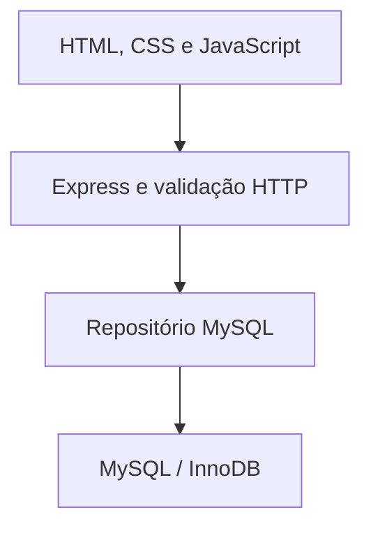

# Arquitetura do InkCircle

O Express serve as páginas do navegador e os endpoints JSON pela mesma origem.

- `src/pages/` contém as páginas.
- `src/js/services/` faz as requisições ao Express.
- `server/app.js` trata HTTP, autenticação e sessão.
- `server/repositorio.js` executa SQL parametrizado e transações.
- `database/schema.sql` define o modelo relacional.

O cadastro, o login, o formulário, o feed e o perfil usam a API. A integração com a Open Library permanece no formulário para sugerir títulos.
