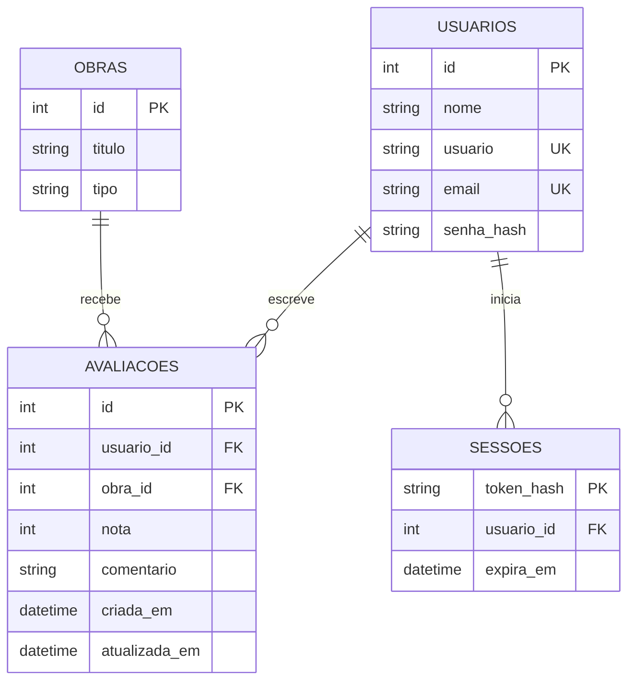

# Etapa 07 — Persistência e CRUD no MySQL

O MySQL é relacional e representa a autoria das avaliações e o vínculo com as obras por meio de chaves estrangeiras. O InnoDB fornece transações para operações que alteram mais de uma tabela. O banco roda como serviço e guarda os dados entre reinicializações do Express.

## Modelo



| Tabela | Regras |
|---|---|
| `usuarios` | Nome de usuário e e-mail únicos. A senha é armazenada como hash scrypt com sal. |
| `obras` | Um registro por par título e tipo. O tipo é livro ou mangá. A comparação segue a collation do banco. |
| `avaliacoes` | Cada avaliação exige uma obra e um autor. Nota inteira de 1 a 5, comentário de 10 a 1000 caracteres e datas em UTC. |
| `sessoes` | Cada sessão pertence a uma conta. O banco guarda o hash do token e a validade de 24 horas. |

Uma conta escreve várias avaliações, e uma obra recebe avaliações de várias contas. As avaliações são a ligação entre os dois grupos. Ao apagar uma avaliação, a obra permanece no catálogo.

## Criação e validação

Crie o banco e o usuário MySQL conforme o [README](../README.md). `npm run db:init` lê [schema.sql](../database/schema.sql) e cria as tabelas com `CREATE TABLE IF NOT EXISTS`, preservando registros em execuções posteriores.

O repositório usa parâmetros para os valores SQL. Na criação, ele localiza ou cadastra a obra e grava a avaliação numa transação. Na edição e na exclusão, ele lê o registro com bloqueio, confirma a autoria e aplica a alteração. Falhas nessas operações provocam rollback e recebem uma resposta JSON de erro. A validação ocorre também no servidor, antes da escrita, e as restrições do banco protegem as relações.

## Exemplos de CRUD com persistência

| Ação no site | Operação | Resultado |
|---|---|---|
| Publicar avaliação | `POST /api/avaliacoes` | MySQL grava e vincula o autor da sessão. |
| Voltar ao perfil | `GET /api/meu-perfil` | Consulta por autor; a avaliação fica visível após recarregar. |
| Abrir a página inicial | `GET /api/avaliacoes` | O feed consulta as avaliações publicadas. |
| Editar no perfil | `PATCH /api/avaliacoes/:id` | A mudança aparece após carregar o perfil ou o feed. |
| Confirmar exclusão | `DELETE /api/avaliacoes/:id` | A avaliação sai do banco e das duas listagens. |

Os corpos JSON para repetir o fluxo constam na [Etapa 6](etapa-06.md). Pelo Workbench, esta consulta mostra a relação entre as tabelas:

```sql
SELECT a.id, u.usuario AS autor, o.titulo, o.tipo, a.nota, a.comentario
FROM inkcircle.avaliacoes a
JOIN inkcircle.usuarios u ON u.id = a.usuario_id
JOIN inkcircle.obras o ON o.id = a.obra_id
ORDER BY a.id DESC;
```

Para demonstrar persistência, publique, pare o Express, inicie-o de novo e atualize o perfil. O registro continua no mesmo banco. `npm run test:mysql` testa duas contas, sessão, reuso de obra, CRUD, bloqueio de alterações por outro autor e persistência ao recriar o servidor HTTP.
