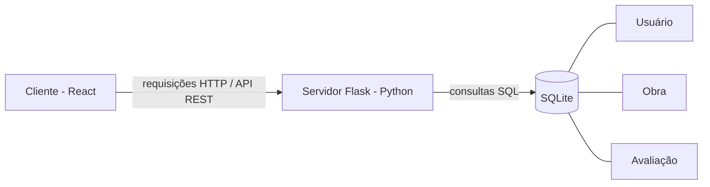

# InkCircle — PROPOSTA E ESPECIFICAÇÃO DO PROJETO

## Nome da aplicação
InkCircle

## Descrição do problema
Leitores de livros e mangás nem sempre costumam registrar suas impressões
de uma obra, nem recomendá-las para outras pessoas. Além disso, plataformas como
Goodreads ou MyAnimeList permitem que esse cenário seja diferente, entretanto 
limitam o serviço ou para livros ou para mangás, nem sempre focando na conexão
entre os leitores. O InkCircle resolve isso oferecendo um espaço que une as duas 
mídias num só lugar, com foco no lado social: publicar comentários sobre obras já 
lidas e encontrar outros leitores com interesses semelhantes.

## Público-alvo
Leitores de livros e mangás que gostam de registrar e compartilhar suas
opiniões sobre as obras que leram, e que têm interesse em encontrar outros
leitores com gostos parecidos.

## Objetivo principal da aplicação
Permitir que o usuário se cadastre, monte um perfil de leitor, publique
avaliações de livros e mangás (nota de 0 a 5 estrelas + comentário) e
encontre outros perfis com interesses de leitura semelhantes.

## Funcionalidades
1. Cadastro e login de usuário.
2. Criação e edição de perfil de leitor.
3. Publicação de avaliação de uma obra (livro ou mangá), com nota de 0 a 5
   estrelas e comentário em texto.
4. Edição e exclusão de avaliações publicadas pelo próprio usuário.
5. Busca de outros perfis de usuários na plataforma.

## Entidades / conceitos do domínio
1. **Usuário** — conta cadastrada na plataforma, com dados de login e perfil.
2. **Obra** — livro ou mangá que pode ser avaliado (título, autor, tipo).
3. **Avaliação** — registro feito por um usuário sobre uma obra, contendo
   nota (0 a 5 estrelas) e comentário.

## Telas / interfaces
1. **Tela de cadastro/login** — formulário para criar conta ou entrar na
   plataforma.
2. **Tela de perfil** — exibe os dados do usuário e a lista de avaliações
   que ele publicou.
3. **Tela de avaliação de obra** — formulário para buscar/selecionar uma
   obra e publicar nota + comentário.
4. **Tela de busca de perfis** — permite procurar e visualizar outros
   usuários da plataforma.

## Operações
1. Criar conta de usuário.
2. Autenticar usuário (login).
3. Criar uma avaliação (obra + nota + comentário).
4. Editar uma avaliação existente.
5. Excluir uma avaliação existente.
6. Buscar usuários por nome/critério.
7. Listar avaliações de um perfil específico.

## Tecnologias
- **Cliente:** React, HTML, CSS, JavaScript
- **Servidor:** Python, com o framework Flask
- **Persistência:** SQLite (acesso via módulo `sqlite3` do Python)

## Arquitetura
Arquitetura cliente-servidor com API REST: o cliente React roda como
aplicação independente no navegador e consome dados do servidor Flask via
requisições HTTP, que processa as regras de negócio e consulta o banco
SQLite, retornando os dados em formato JSON.

## Diagrama simples da solução

